# 实验证据图（16 张）

> 全部由 `scripts/make_evidence_charts.py` 从仓库内实验 JSON 生成，深色 1920×1080，标题即结论，页脚标注来源与样本量。不是手绘示意图；改动数据后重跑脚本即可复现。

复现：`python scripts/make_evidence_charts.py`（输出 `docs/evidence/shots/final/charts/` 与本清单）。

| # | 图 | 结论 | 来源 / n |
|---|---|---|---|
| 01 | 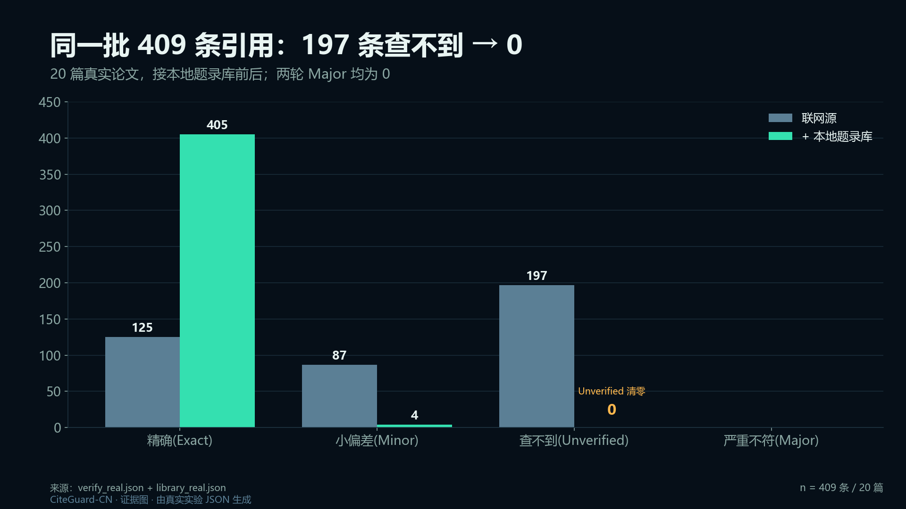 | 同一批 409 条引用：197 条查不到 → 0 | verify_real.json + library_real.json；n=409/20篇 |
| 02 | 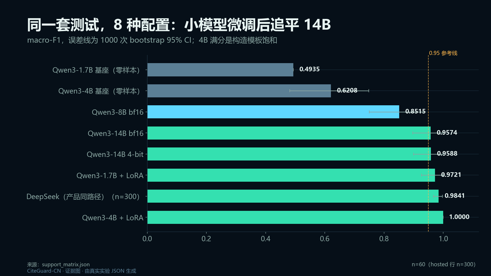 | 同一套测试，8 种配置：小模型微调后追平 14B | support_matrix.json；n=60 |
| 03 | 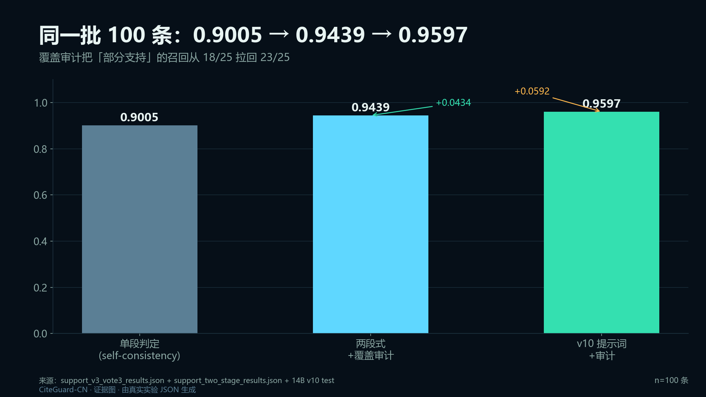 | 同一批 100 条：0.9005 → 0.9439 → 0.9597 | support_v3_vote3 + support_two_stage + 14B v10；n=100 |
| 04 | 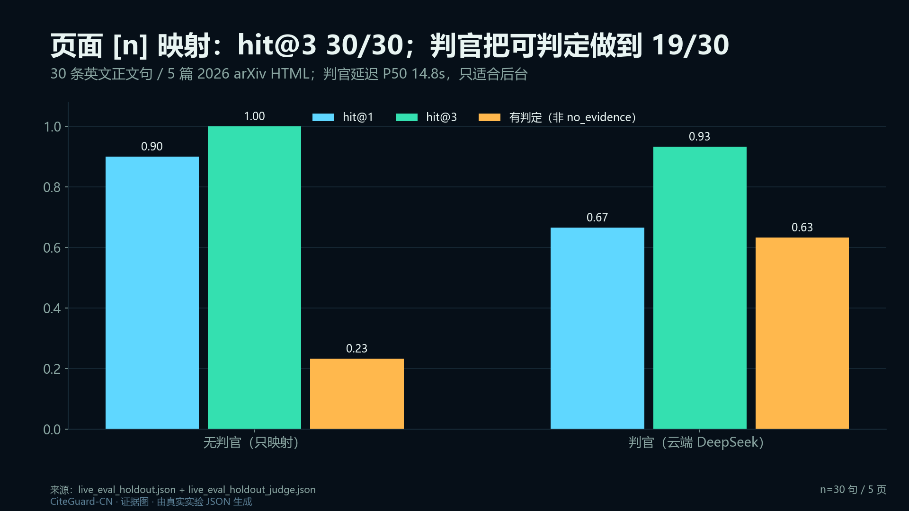 | 页面 [n] 映射：hit@3 30/30；判官只改四档（有判定 0.37→0.43→0.60），不改命中 | live_eval_holdout_enriched + fast_warm + judge_v2；n=30 |
| 05 | 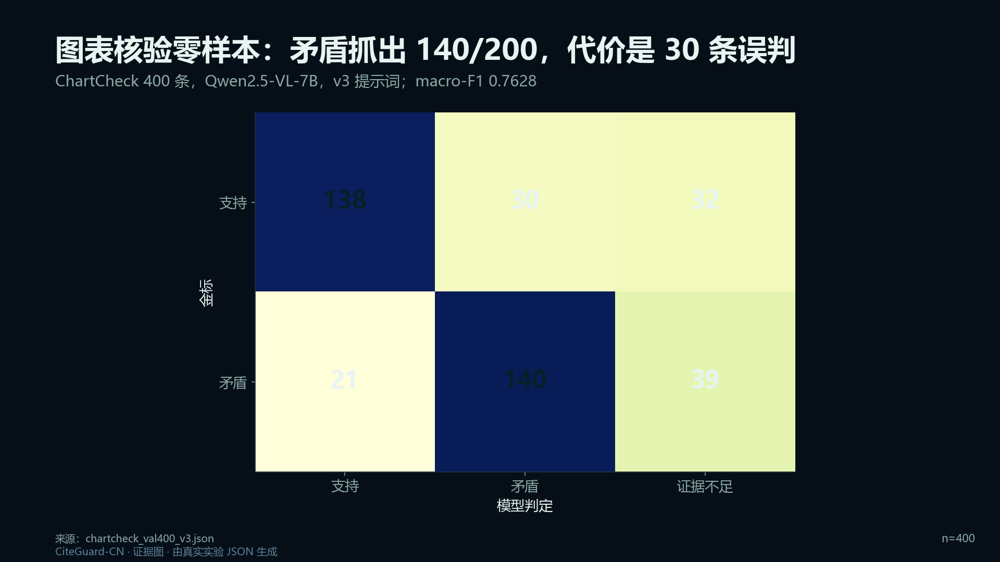 | 图表核验零样本：矛盾抓出 140/200，代价是 30 条误判 | chartcheck_val400_v3.json；n=400 |
| 06 | 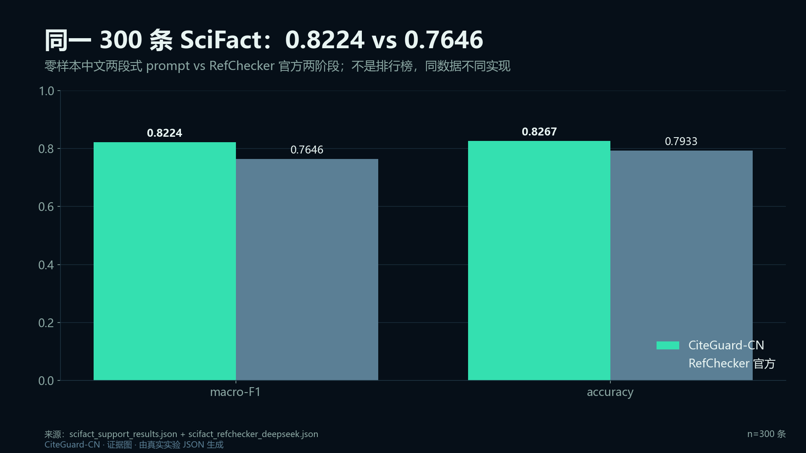 | 同一 300 条 SciFact：0.8224 vs 0.7646 | scifact support + refchecker；n=300 |
| 07 | 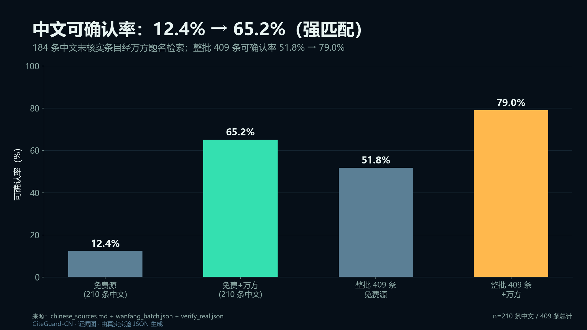 | 中文可确认率：12.4% → 65.2%（强匹配） | chinese_sources + wanfang_batch；n=210/409 |
| 08 | 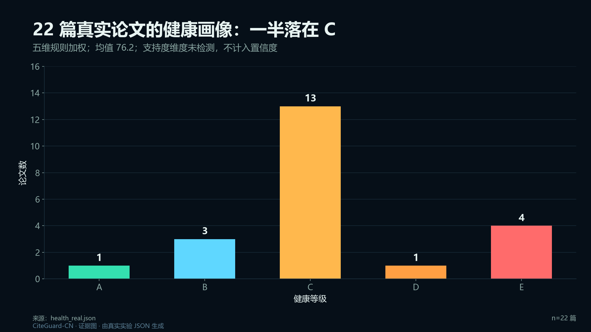 | 22 篇真实论文的健康画像：一半落在 C | health_real.json；n=22 |
| 09 | 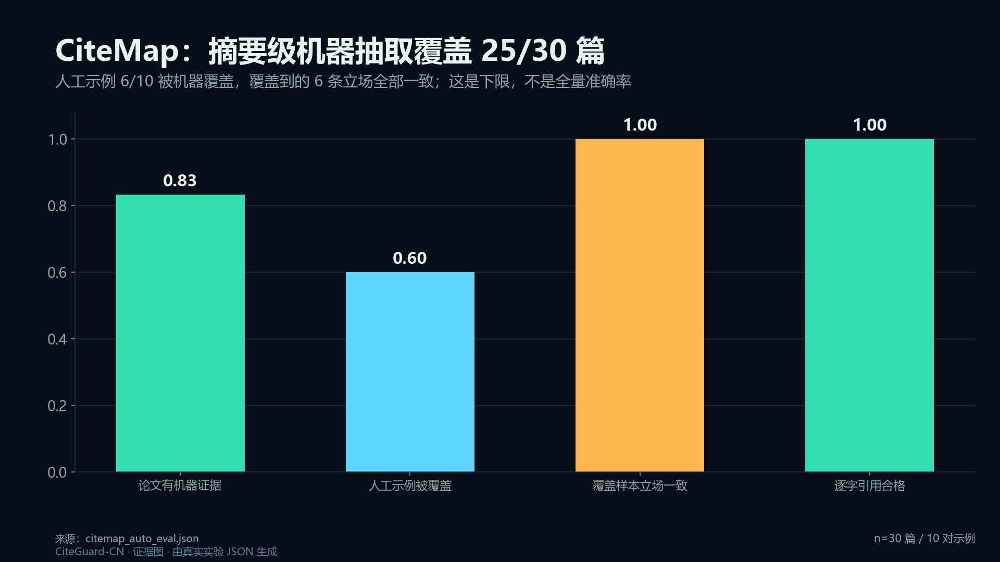 | CiteMap：摘要级机器抽取覆盖 25/30 篇 | citemap_auto_eval.json；n=30/10 |
| 10 | 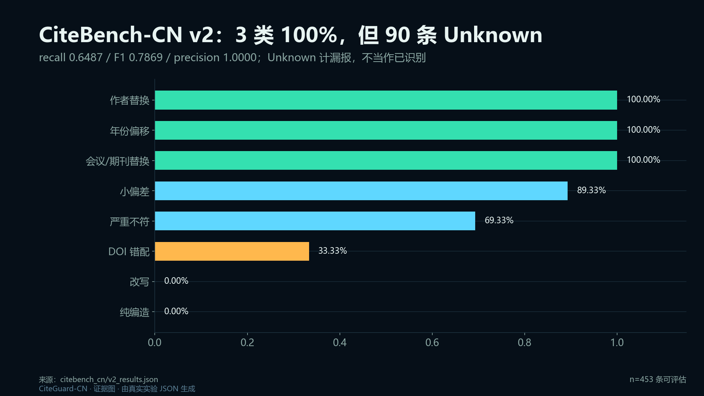 | CiteBench-CN v2：3 类 100%，但 90 条 Unknown | v2_results.json；n=453 |
| 11 | 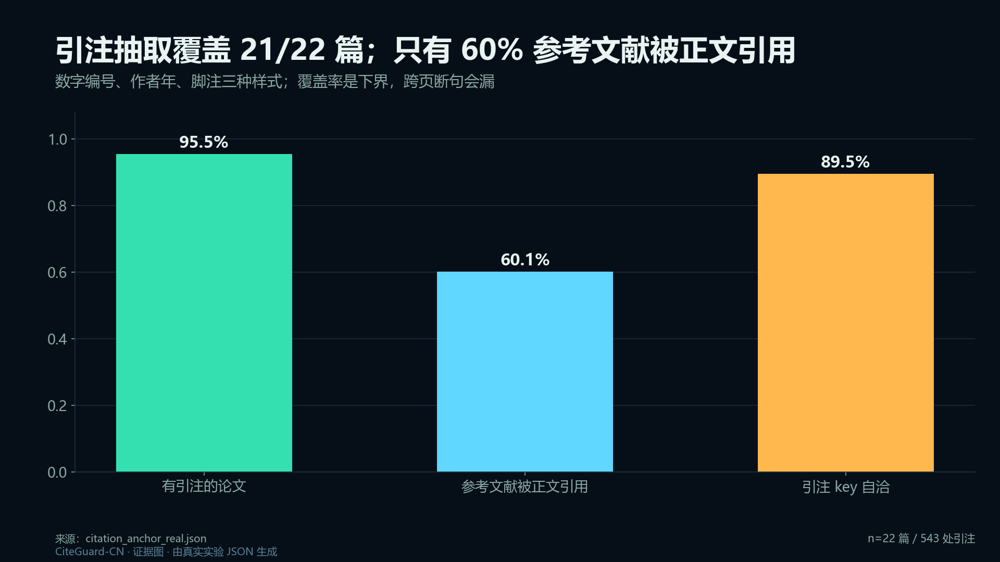 | 引注抽取覆盖 21/22 篇；只有 60% 参考文献被正文引用 | citation_anchor_real.json；n=22/543 |
| 12 | 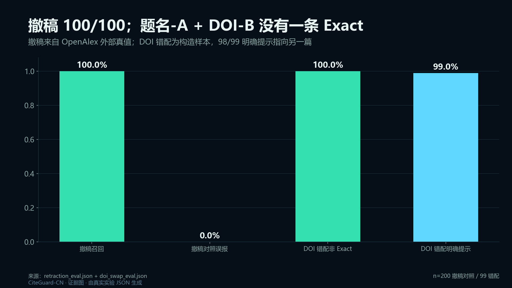 | 撤稿 100/100；题名-A + DOI-B 没有一条 Exact | retraction_eval + doi_swap_eval；n=200/99 |
| 13 | 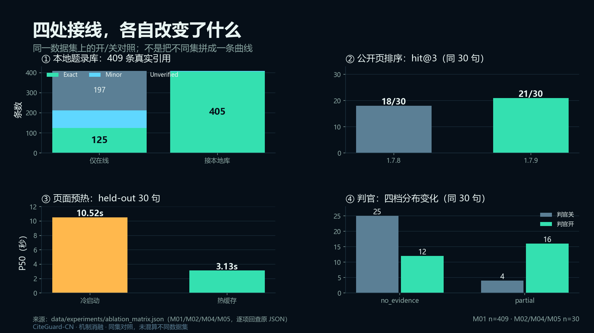 | 机制开/关：本地库、排序、预热、判官各自改变了什么 | ablation_matrix.json；M01 n=409，M02/M04/M05 n=30 |
| 14 | 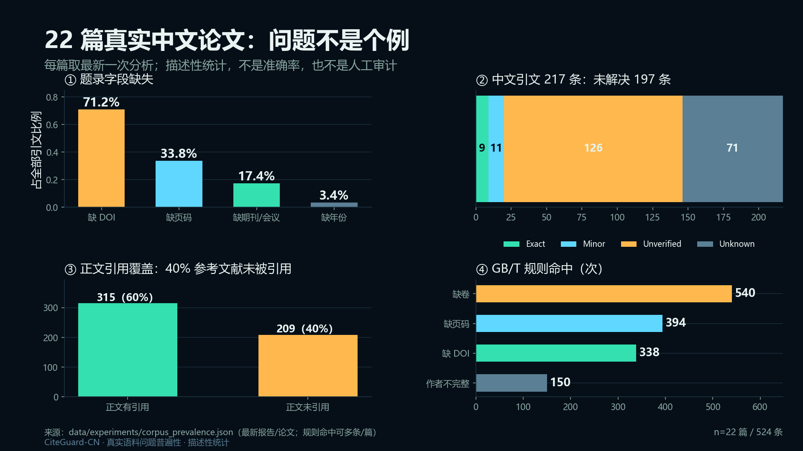 | 22 篇真实中文论文：71.2% 缺 DOI、39.9% 未被正文引用 | corpus_prevalence.json；n=22/524 |
| 15 | 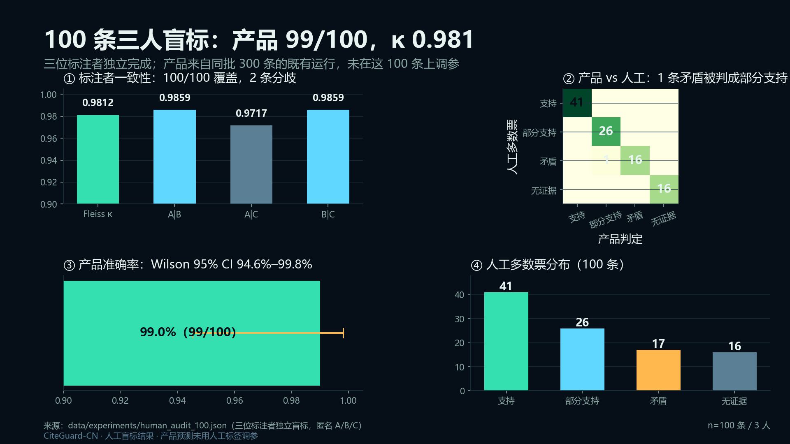 | 100 条三人盲标：一致性 κ 0.981；产品 99/100，macro-F1 0.988 | human_audit_100.json；n=100 / 3 人 |

## 使用边界

- 这些图是**证据图**，不是海报：坐标轴、n、来源都在图上/页脚；不要把不同口径的分数放进同一张图。
- 409 条真实语料是 22 篇已发表论文的参考文献，不是随机抽样；`Unverified` 不等于错误。
- 支持度矩阵中 4B LoRA 的 1.0000 来自构造模板饱和（60/60），不能写成“4B 强于 14B”；正文和答辩都要带这句边界。
- Live 的 no-judge 与 judge 两套结果分开画；judge 跑的是同一 held-out，但输出不是人工金标。
- CiteMap 机器抽取只读摘要，`verified=false`；60 格人工核对未完成，不得把机器结果画成人工核对。

## 16. 全文原子证据核验（1.7.28）

`16-fulltext-atomic.png`：21 条原子断言 × 21 篇全文 = 213 组合；完整支持 5、部分支持 8、无证据 200；人工正例（有全文）3/7 命中。来源 `data/experiments/citemap_atomic_fulltext_summary.json`，复现 `scripts/eval_citemap_atomic_fulltext.py` + `scripts/summarize_citemap_atomic_fulltext.py`。
