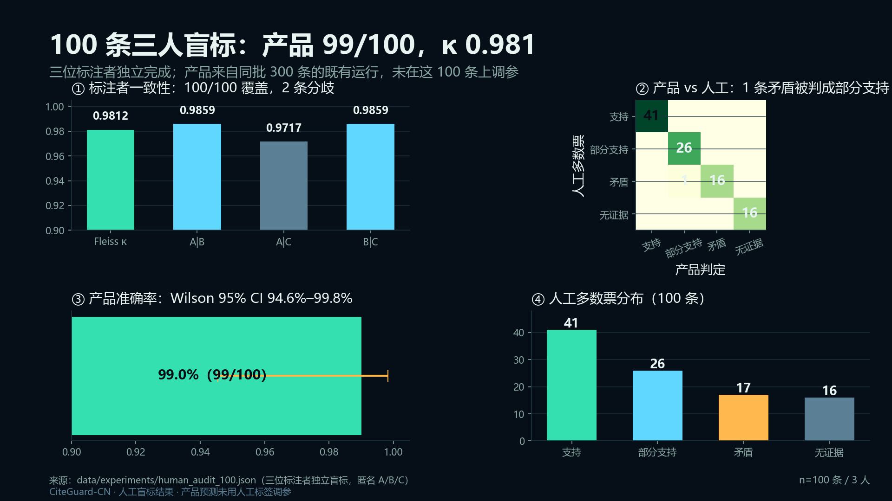

# 100 条三人盲标：结果

2026-11-15，三位标注者（匿名 A / B / C）独立完成了 CiteGuard-CN 的 100 条支持度盲标。这是本项目第一次拿到**独立于构造规则**的人工标签，用于回答一个之前一直空着的问题：

> 产品在“人怎么看”的标签上，到底准不准？

先说结论：**三人一致性 Fleiss κ = 0.981；产品对三人多数票 99/100，macro-F1 0.988，产品与多数票的 Cohen κ = 0.986。** 只有 1 条判错，2 条标注者之间 2:1 分歧，没有平票。



## 1. 怎么做的

- 题目：`data/audit/audit_sheet_100.csv`，100 条断言—证据对，覆盖 support / partial / contradict / no_evidence 四档。
- 标注：A / B / C 三人各拿到一份独立打乱顺序的 CSV；互相看不到对方标签，也看不到构造 key。说明与练习见 [盲标说明](human_audit.md)。
- 原始文件：`data/audit/human_100/audit_A.csv`、`audit_B.csv`、`audit_C.csv`（B 原始文件实际是 XLSX，已转为 CSV；三份均 100/100 填满）。
- 产品预测：直接取同一批 300 条数据在 `data/experiments/release300.json` 中的既有预测，**没有**用这 100 条人工标签调参、挑阈值或重跑。
- 评分脚本：`scripts/score_human_audit_100.py`；结果：`data/experiments/human_audit_100.json`。

## 2. 标注者之间

| 指标 | 值 |
|---|---|
| 覆盖 | A 100/100、B 100/100、C 100/100 |
| Fleiss κ（三人） | **0.98116** |
| pairwise Cohen κ | A\|B 0.98588；A\|C 0.97170；B\|C 0.98588 |
| 多数票分布 | support 41 / partial 26 / contradict 17 / no_evidence 16 |
| 分歧 | 2 条（HS021、HS034），均为 2:1；无平票 |
| 与构造 key 一致 | 99/100（key 只是参考，不是人工真值） |

两条分歧都出在“部分支持”的边界上：

- **HS021**：A/B 认为证据只覆盖了“受要素结构、产业结构和政策影响”，缺“农村经济发展并非独立过程”的前提，判 partial；C 认为两者一致，判 support。
- **HS034**：A 认为证据支持联合治疗有治疗潜力，判 support；B/C 认为缺“与疾病网络复杂性一致”的限定，判 partial。

这两条没有被第三方仲裁；下文使用三人多数票，并明确 2:1 的性质。它们是“边界样本本身有歧义”的例子，不是标注错误。

## 3. 产品对三人多数票

| 指标 | 值 |
|---|---|
| 映射到产品预测 | 100/100 |
| 准确率 | **0.9900（99/100）** |
| Wilson 95% CI | 94.55%–99.82% |
| macro-F1 | **0.98771** |
| macro-F1 bootstrap 95% CI | 0.9578–1.0000 |
| 与多数票的 Cohen κ | **0.98589** |

混淆矩阵（行=人工多数票，列=产品判定；顺序 support / partial / contradict / no_evidence）：

```
[[41,  0,  0,  0],
 [ 0, 26,  0,  0],
 [ 0,  1, 16,  0],
 [ 0,  0,  0, 16]]
```

唯一错误是 **HS032**（对应数据集 `c2-0048`）：人工判 contradict，产品判 partial。这条是“削弱/增强”方向的语义边界，产品没有抓住反义方向。

逐条人工标签在 `data/audit/human_100/` 的三份 CSV 中；产品预测与不一致项在 `data/experiments/human_audit_100.json` 的 `product.mismatches` 中。

## 4. 这能说明什么、不能说明什么

**能说明：**

- 三位标注者按同一说明能高度一致地使用四档标签（κ 0.981），说明这套标签不是随意定义。
- 产品在 100 条独立人工多数票上 99/100，且产品预测是在看到这批标签之前产生的，不是事后拟合。
- 主要错误集中在 support/partial/contradict 的语义边界，而不是随机乱判。

**不能说明：**

- 这 100 条来自构造集的分层抽样，**不是随机抽样**，不能直接外推到所有中文论文。
- 三人多数票不是“绝对真值”；2 条分歧仍是 2:1，没有仲裁。
- 产品 macro-F1 的 bootstrap CI 上界是 1.0，但下界只有 0.958，样本量仍然是 100。
- 这不能替代同行评审，也不能证明“AI 判对了所有引用”；它是支持度判定的受控评测。

## 5. 复现

```bash
# 原始三份 CSV/XLSX 在 data/audit/human_100/
PYTHONPATH=src python scripts/score_human_audit_100.py \
  --raw data/audit/human_100 \
  --key data/audit/audit_key_100.json \
  --dataset data/claimsupport_cn/claimsupport_cn_300.jsonl \
  --predictions data/experiments/release300.json \
  --out data/experiments/human_audit_100.json
```

生成图 15：

```bash
python scripts/make_evidence_charts.py
```

## 6. 口径

- 标注者匿名，不记录姓名；原始 CSV 只保留 A/B/C 代号。
- 产品预测来自既有 300 条运行，未在这 100 条上调参。
- 构造 key 与人工标签是两套东西：构造 key 只用于检查流程，不作为人工真值。
- 所有数字来自 `data/experiments/human_audit_100.json`，可以逐条重算。
