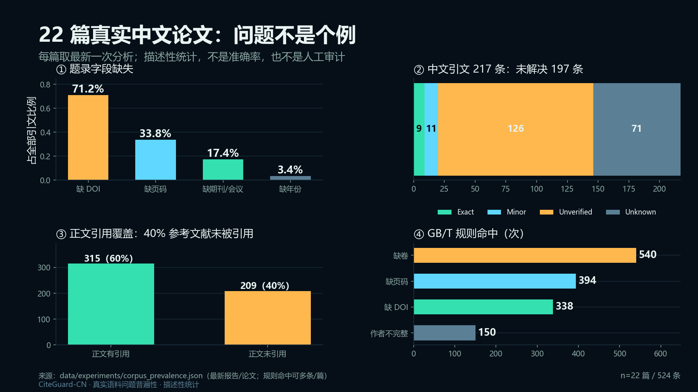

# 真实语料里的引文问题有多普遍

> 结论先行：在我们收集的 **22 篇真实中文论文、524 条参考文献**中，**71.2% 缺 DOI、33.8% 缺页码、39.9% 未被正文引用**；217 条中文引文里有 **197 条（90.8%）** 无法只靠免费开放源完成核验。
>
> 这是描述性统计，不是准确率、不是人工审计，也不是随机抽样推断。



## 怎么算

对 `data/real_corpus` 中每篇 PDF，取最新一次完成的分析报告（同一文件多跑只保留最新），读取每条引文的解析字段、GB/T 规则命中、核验状态和正文引用覆盖。

口径：

- **缺字段**：解析结果中该字段为空；只说明抽取/原文里没有，不代表原论文一定没有。
- **GB/T 规则命中**：同一引文可命中多条（如同时缺卷、缺页码），所以面板 ④ 是“次”而不是“条”。
- **中文引文未解决** = 核验状态为 `Unverified` 或 `Unknown`；`Unverified` 是没找到可信匹配，不是“判假”。
- **正文未引用**：该参考文献编号没有在正文引注中出现的记录。

## 数字

| 指标 | 数值 |
|---|---|
| 论文数 / 参考文献数 | 22 篇 / 524 条 |
| 缺 DOI | 373 条（71.2%） |
| 缺页码 | 177 条（33.8%） |
| 缺期刊/会议 | 91 条（17.4%） |
| 缺年份 | 18 条（3.4%） |
| 中文引文 / 未解决 | 217 条 / 197 条（90.8%） |
| 正文未引用 | 209 条（39.9%） |
| 核验状态 | Exact 148 / Minor 138 / Unverified 154 / Unknown 75 / Major 9 |

`Major 9` 已人工回溯为两篇双栏 PDF 的 DOI 截断噪声，不是“真论文判假”。

## 边界

- 22 篇来自我们自己的课程/公开论文语料，**不是随机抽样**，不能外推为“中文论文都这样”。
- 规则命中包含“建议补充”级别的 warning，说明的是**规范性工作量**，不等于学术错误。
- 数字可用于说明“问题真实存在、值得做一个工作台”，不能用于宣称“我们比人工更准”。

## 复现

```bash
python scripts/analyze_corpus_prevalence.py
python scripts/make_evidence_charts.py
```

原始 JSON：`data/experiments/corpus_prevalence.json`；图：`docs/evidence/shots/final/charts/14-prevalence.png`；生成脚本：`scripts/analyze_corpus_prevalence.py`、`scripts/make_evidence_charts.py`。
