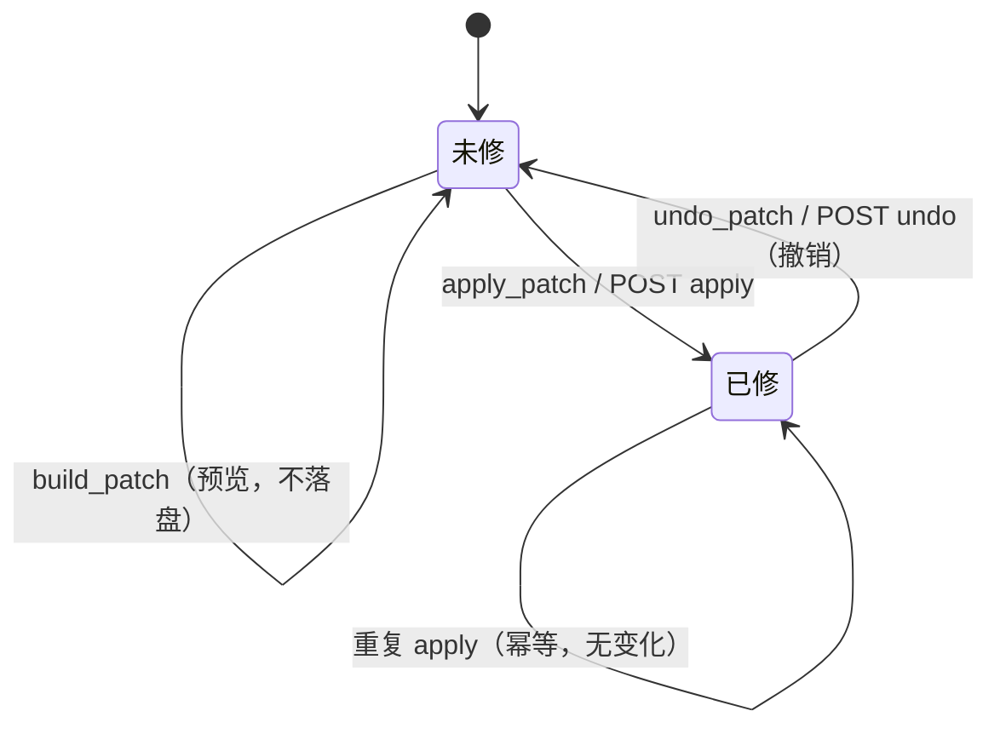

# 修复闭环：数据层、接口契约与 UI 交互

> 本文是 C1a 的交付契约。数据层已实现在 `src/citeguard/fix.py`，测试在
> `tests/test_fix.py`；**路由、持久化落盘与前端由队长按本文实现**。现有
> `GET /api/report/{id}/fixed` 与 `fixed.txt` 保持兼容，不在此次改动范围内。

## 1. 目标与边界

一轮修复闭环包含四个动作：

1. **预览**：算出「哪些条目可以重排、修复前后差在哪」，不改变报告；
2. **应用**：把修订后的参考文献文本记到报告副本上（可单条/批量/全部）；
3. **撤销**：撤掉最近一次应用，恢复原文与「未修」状态；
4. **展示**：在报告页显示修复前后 diff、已修徽标、撤销入口。

硬边界：

- **只重排已解析字段，不联网补全、不改写正文**。缺失字段继续标「缺」。
- **原始证据不可变**：修复不覆盖 `references[i].raw` / `references[i].parsed`，
  修订文本单独存在 `references[i].repair.after`。撤销 = 删除 `repair` 记录，
  报告逐字节回到修复前。
- **数据层纯函数**：`build_patch` / `apply_patch` / `undo_patch` 不写磁盘、
  不读全局状态、不修改入参（返回深拷贝）。
- 主路由、任务目录写入、撤销 TTL 计时都由 web 层负责；`fix.py` 不 import
  `web`、不 import `config`。

## 2. 数据模型

### 2.1 报告条目的 `repair` 记录

应用补丁后，`report["references"]` 中被修复的条目多一个 `repair` 对象：

```json
{
  "index": 3,
  "raw": "[3] ZHANG San; LI Si. A study of citation practice. Journal of Tests, 2020, 12 (3): 45-50",
  "parsed": { "...": "..." },
  "verify": { "...": "..." },
  "compliance": { "...": "..." },
  "repair": {
    "state": "fixed",
    "patch_id": "rp-0123456789ab",
    "before": "[3] ZHANG San; LI Si. A study of citation practice. Journal of Tests, 2020, 12 (3): 45-50",
    "after": "ZHANG San, LI Si. A study of citation practice[J]. Journal of Tests, 2020, 12(3): 45-50.",
    "fixes": ["补文献类型码", "作者分隔符统一为逗号"],
    "missing": ["DOI"],
    "safe": true
  }
}
```

约定：

- `state` 只会是 `"fixed"`。**未修 = 没有 `repair` 键**（不写 `state: "unfixed"`
  的空对象，保证撤销后与原报告完全相等）。
- `before` / `after` 是纯文本，供 UI 展示 diff；`after` 才是用户可复制的修订文本。
- `patch_id` 标识「是哪一次补丁写入了它」，撤销时按它匹配，避免误撤别的批次。
- `fixes` / `missing` / `safe` 与现有 `fix_entry()` 输出同义，供标签展示。

### 2.2 补丁文档（`build_patch` 的返回值）

```json
{
  "schema": "citeguard.repair_patch/1",
  "patch_id": "rp-0123456789ab",
  "reversible": true,
  "report_fingerprint": "rf-abcdef0123456789",
  "report_total": 15,
  "indexes": [1, 2, 3],
  "before": [
    { "index": 1, "entry": "原文 …", "state": "unfixed" }
  ],
  "after": [
    { "index": 1, "entry": "修订后 …" }
  ],
  "entries": [
    {
      "index": 1,
      "state": "pending",
      "previous_state": "unfixed",
      "changed": true,
      "already_fixed": false,
      "before": "原文 …",
      "after": "修订后 …",
      "fixes": ["补文献类型码"],
      "missing": ["DOI"],
      "safe": true,
      "diff": [
        { "op": "equal",   "before": "[1] ZHANG San; LI Si. ", "after": "[1] ZHANG San; LI Si. " },
        { "op": "replace", "before": ". A study",              "after": "ZHANG San, LI Si. A study" }
      ]
    }
  ],
  "ops": [
    {
      "op": "set_repair",
      "index": 1,
      "before": "原文 …",
      "after": "修订后 …",
      "fixes": ["补文献类型码"],
      "missing": ["DOI"],
      "safe": true
    }
  ],
  "summary": {
    "total": 15,
    "selected": 3,
    "changed": 3,
    "to_apply": 3,
    "already_fixed": 0,
    "unchanged": 0,
    "safe": 3,
    "with_missing": 1
  }
}
```

字段说明：

| 字段 | 含义 |
| --- | --- |
| `patch_id` | 确定性 ID：`"rp-" + sha1(schema + fingerprint + ops)[:12]`。同一报告、同一选择，重复预览得到同一个 ID |
| `report_fingerprint` | 报告依赖字段（序号 + `raw` + `parsed`）的哈希。报告被重新分析/改写后旧补丁失效 |
| `indexes` | 本次选中的条目序号，按报告顺序升序，已去重 |
| `before` / `after` | 逐条对照用的扁平列表，`state` 是应用前该条目的状态 |
| `entries` | 完整预览：状态、修复项、缺失字段、字符级 diff |
| `diff` | `difflib` 的字符级 opcode：`equal` / `replace` / `delete` / `insert`；两侧文本都保留，拼接 `before` 侧可还原原文、拼接 `after` 侧可还原修订文 |
| `ops` | 真正要写入报告的操作；**只有「有变化且尚未修复」的条目才产生 op**。`unchanged` / 已修条目只出现在预览里 |
| `summary.to_apply` | 本次 apply 将写入的条目数（前端按钮上的数字用它，而不是 `changed`） |
| `reversible` | 恒为 `true`；数据层保证删除 `repair` 即可回到原文 |

`entries[].state`：

| 值 | 含义 | UI |
| --- | --- | --- |
| `pending` | 有修订文本且尚未修复 | 可应用，显示 diff |
| `fixed` | 已按同一 `after` 修复过 | 显示「已修」，不重复写入 |
| `unchanged` | 重排后与原文一致 | 不产生 op，列表里可折叠 |

### 2.3 报告级状态

`repair_state(report)` 返回：

```json
{
  "schema": "citeguard.repair_state/1",
  "state": "partially_fixed",
  "label": "部分已修",
  "total": 15,
  "fixed": 3,
  "unfixed": 12,
  "patch_ids": ["rp-0123456789ab"],
  "entries": [
    { "index": 1, "state": "fixed", "patch_id": "rp-…", "before": "…", "after": "…" }
  ]
}
```

`state` 取值：`unfixed`（未修）/ `partially_fixed`（部分已修）/
`fixed`（全部已修）。`reverted`（已撤销）不是持久状态，只是撤销接口响应里的
动作结果标签（见 `REPAIR_STATE_LABELS`）。

## 3. 状态机

单条条目：



报告级聚合：`unfixed` →（部分应用）→ `partially_fixed` →（全部应用）→ `fixed`；
任一批次撤销后按剩余 `repair` 记录重新聚合。撤销只影响 `patch_id` 匹配的条目；
更早批次留下的修复保持不动。

关键性质：

- **幂等**：同一补丁重复 `apply_patch`，结果报告完全相等；重复撤销已撤销的条目
  是 no-op。
- **可逆**：`undo_patch(apply_patch(report, patch), patch) == report`（浅层字段
  逐字节一致，`repair` 键消失）。
- **过期保护**：补丁带 `report_fingerprint`；报告被重新分析后 apply/undo 抛
  `ValueError`，接口映射为 `409 stale_patch` / `409 undo_expired`。
- **批次匹配**：undo 只删除 `repair.patch_id == patch.patch_id` 的记录，防止
  一次撤销误伤别的批次。

## 4. Python 数据层 API（已实现）

```python
from citeguard.fix import (
    REPAIR_SCHEMA,             # "citeguard.repair_patch/1"
    REPAIR_STATE_SCHEMA,       # "citeguard.repair_state/1"
    REPAIR_STATE_LABELS,       # {"unfixed": "未修", "fixed": "已修", "reverted": "已撤销"}
    REPAIR_UNDO_TTL_SECONDS,   # 1800，web 层撤销窗口的默认值
    build_patch, apply_patch, undo_patch, revert_patch, repair_state,
)
```

| 函数 | 返回 | 说明 / 异常 |
| --- | --- | --- |
| `build_patch(report, indexes=None)` | 补丁文档（§2.2） | `indexes=None` 表示全部条目；`[]` 表示空选择（合法，`to_apply=0`）。非整数、`<1`、超出报告范围 → `ValueError` |
| `apply_patch(report, patch)` | 新的 report（深拷贝） | 不修改入参；写入 `references[i].repair`。补丁指纹与当前报告不符、`ops` 非法、条目不存在 → `ValueError` |
| `undo_patch(report, patch=None, indexes=None)` | 新的 report（深拷贝） | `patch` 只撤该批次匹配 `patch_id` 的记录；`indexes` 再限定序号；两者都省略 = 撤销全部修复。已未修的条目跳过（幂等）。非法序号 / 指纹不符 → `ValueError` |
| `revert_patch(...)` | 同 `undo_patch` | 别名，语义与参数完全一致 |
| `repair_state(report)` | 状态快照（§2.3） | 只读；供 `GET …/repair/state` 直接返回 |

使用示例：

```python
patch = build_patch(report)                 # 全部可修复条目
patch = build_patch(report, [2, 5])         # 单条 / 指定批量

repaired = apply_patch(report, patch)       # 原 report 不变
assert repaired["references"][1]["repair"]["after"].endswith(".")

restored = undo_patch(repaired, patch)      # 回到未修
assert restored == report
```

注意：`fix_report()` / `as_text()` 保持原行为，读取的是 `raw/parsed` 的预览，
不会自动感知 `repair`。展示「已修文本 / 导出修订表」时请优先取
`references[i].repair.after`（回退 `raw`）。

## 5. 持久化契约（队长实现）

推荐三个文件，互不覆盖：

```
data/jobs/<job_id>/
  report.json          # 分析产物，修复闭环永远不写它（证据不可变）
  report.fixed.json    # 当前修复视图：对 report.json（或上一版视图）apply_patch 的结果
  repair.json          # 最近一次应用的补丁元数据（撤销窗口的依据）
```

`repair.json`：

```json
{
  "schema": "citeguard.repair_store/1",
  "patch_id": "rp-0123456789ab",
  "report_fingerprint": "rf-abcdef0123456789",
  "applied_at": "2026-11-14T00:30:00+00:00",
  "indexes": [1, 2, 3],
  "patch": { "...": "build_patch 返回的完整补丁文档（至少保留 ops / patch_id / report_fingerprint / indexes）" }
}
```

读取逻辑（所有 `repair/*` 接口统一入口）：

```python
def _load_active_report(job_id):
    base = _load_report(job_id)
    if base is None:
        return None
    fixed = _load_json(repair_dir / "report.fixed.json")
    return fixed or base
```

应用流程：

1. `active = _load_active_report(job_id)`；`indexes` 缺省 = 全部（`None`）。
2. `patch = build_patch(active, indexes)`。
3. 若请求带 `patch_id` 且与 `patch["patch_id"]` 不一致：先看它是否等于
   `repair.json` 里的最新 `patch_id`（说明重复点击）→ 是则直接返回
   `200 already_applied`；否则 `409 stale_patch`。
4. `repaired = apply_patch(active, patch)`。
5. 写 `report.fixed.json`（原子替换，`tmp` + `replace`）；写 `repair.json`
   （`applied_at` 用 UTC ISO8601）。两次写入失败要回滚已写文件。
6. 返回补丁 + 新状态 + 撤销信息。

撤销流程：

1. 读 `repair.json`；不存在 → `200 already_undone`（幂等，不是错误）。
2. 校验 `patch_id`（若请求带）与 `applied_at + REPAIR_UNDO_TTL_SECONDS`；
   超时 → `409 undo_expired`。
3. 校验 `patch.report_fingerprint` 与当前 `report.json` 指纹一致（复用
   `build_patch(report.json)` 的指纹即可）；不一致说明报告已重跑 →
   `409 undo_expired`（提示重新分析）。
4. `restored = undo_patch(active, patch, indexes=requested_indexes)`。
5. 若 `repair_state(restored)["fixed"] == 0`：删除 `report.fixed.json` 与
   `repair.json`；否则写回 `report.fixed.json`，并按剩余修复更新 / 删除
   `repair.json`（保留最近一次未完全撤销的补丁；已无撤销窗口时删除）。
6. 返回 `undone` / `skipped` / 新状态。

并发与锁：apply/undo 都用同一把 `threading.Lock`（按 job_id）串行化，避免
「边修边撤」写坏 JSON。文件读写使用现有 `tmp.replace(p)` 模式。

## 6. HTTP API 契约（队长实现）

约定：

- 路由前缀：`/api/report/{job_id}/repair/`；`job_id` 必须匹配现有
  `_JOB_RE`（`[A-Za-z0-9_-]{1,64}`），否则 404。
- 成功响应 `application/json`；失败统一为 FastAPI 的
  `{"detail": {"code": "...", "message": "...", ...}}`，`code` 稳定、可前端分支。
- 鉴权沿用全局 `X-API-Key` / Bearer 中间件，文档不重复。
- 所有接口只读 `report.json`；写只发生在 `report.fixed.json` / `repair.json`。

### 6.1 `GET /api/report/{job_id}/repair/preview`

只读预览，不落盘。

Query：

| 参数 | 必填 | 说明 |
| --- | --- | --- |
| `indexes` | 否 | 逗号分隔的条目序号，如 `1,3,5`。省略 = 全部；空串/非整数/越界 → 400 |

响应 `200`：`build_patch` 的完整补丁文档（§2.2）。示例：

```json
{
  "schema": "citeguard.repair_patch/1",
  "patch_id": "rp-0123456789ab",
  "reversible": true,
  "report_fingerprint": "rf-…",
  "indexes": [1, 3],
  "before": [{"index": 1, "entry": "…", "state": "unfixed"}],
  "after": [{"index": 1, "entry": "…"}],
  "entries": [{"index": 1, "state": "pending", "changed": true, "diff": []}],
  "ops": [{"op": "set_repair", "index": 1, "before": "…", "after": "…"}],
  "summary": {"total": 15, "selected": 2, "changed": 2, "to_apply": 2,
               "already_fixed": 0, "unchanged": 0, "safe": 2, "with_missing": 0}
}
```

错误：`404 report_not_ready`、`400 invalid_index`。

### 6.2 `POST /api/report/{job_id}/repair/apply`

Payload：

```json
{
  "indexes": [1, 2, 3],
  "patch_id": "rp-0123456789ab"
}
```

`indexes` 可省略或为 `null`（= 全部当前可修复条目）；`patch_id` 可省略（服务端
现算）。`indexes: []` → 400 `invalid_index`（前端不应发空选择）。

语义：

- 重新 `build_patch(active, indexes)`；
- 若 `patch_id` 等于已应用的最新 `repair.json.patch_id` → 幂等成功
  `{"applied": 0, "already_applied": true}`；
- 若 `patch_id` 与重新构建的补丁不一致 → `409 stale_patch`；
- 若 `summary.to_apply == 0` → `200`，`applied: 0`，状态照常返回（重复点击不报错）；
- 否则应用、落盘，`applied = summary.to_apply`。

响应 `200`：

```json
{
  "ok": true,
  "patch_id": "rp-0123456789ab",
  "applied": 3,
  "already_applied": false,
  "indexes": [1, 2, 3],
  "patch": { "...": "补丁文档，便于前端立即渲染 diff" },
  "state": { "...": "repair_state(修复后) + undo 块（见 6.4）" },
  "message": "已修复 3 条，30 分钟内可撤销"
}
```

错误：`400 invalid_index` / `400 bad_request`、`404 report_not_ready`、
`409 stale_patch`、`500 repair_failed`。

### 6.3 `POST /api/report/{job_id}/repair/undo`

Payload：

```json
{
  "patch_id": "rp-0123456789ab",
  "indexes": [2]
}
```

两个字段都可省略：`patch_id` 省略 = 撤销最近一次批次；`indexes` 省略 = 撤销该
批次全部条目，指定时 = 只撤销其中几条（逐条撤销）。

语义：

- 无 `repair.json` → `200 {"ok": true, "undone": 0, "already_undone": true, "state": …}`
- `patch_id` 与最新批次不符 → `409 stale_patch`
- 超过 `applied_at + 1800s`，或 `report.json` 已变化 → `409 undo_expired`
- 否则 `undo_patch(active, patch, indexes)`，落盘并返回新状态。

响应 `200`：

```json
{
  "ok": true,
  "undone": 3,
  "skipped": 0,
  "already_undone": false,
  "indexes": [1, 2, 3],
  "state": { "...": "repair_state(撤销后) + undo 块" },
  "message": "已撤销 3 条"
}
```

错误：`400 invalid_index`、`404 report_not_ready`、`409 stale_patch`、
`409 undo_expired`、`500 repair_failed`。

### 6.4 `GET /api/report/{job_id}/repair/state`

页面加载 / 任意修复动作后刷新状态。

响应 `200`：

```json
{
  "schema": "citeguard.repair_state/1",
  "state": "partially_fixed",
  "label": "部分已修",
  "total": 15,
  "fixed": 3,
  "unfixed": 12,
  "patch_ids": ["rp-0123456789ab"],
  "entries": [
    { "index": 1, "state": "fixed", "patch_id": "rp-…", "before": "…", "after": "…" }
  ],
  "undo": {
    "available": true,
    "patch_id": "rp-0123456789ab",
    "applied_at": "2026-11-14T00:30:00+00:00",
    "expires_at": "2026-11-14T01:00:00+00:00",
    "indexes": [1, 2, 3]
  }
}
```

无修复 / 撤销窗口关闭时固定返回 `undo` 对象且 `available: false`，其余字段为
`null`（字段稳定，前端无需判空两种形态）。`entries` 与 §2.3 一致。

### 6.5 错误码表

| HTTP | `detail.code` | 触发场景 | 前端处理 |
| --- | --- | --- | --- |
| 400 | `invalid_index` | 序号非整数、`< 1`、超出 1..N、空选择 | 清空选择并提示「条目已变化，请刷新」 |
| 400 | `bad_request` | body 不是对象 / `indexes` 不是数组 / `patch_id` 非字符串 | 修正请求；一般不应出现 |
| 404 | `report_not_ready` | `report.json` 不存在或任务未完成 | 跳回任务进度页 |
| 409 | `stale_patch` | `patch_id` 与当前预览/最新批次不符 | 自动重新 `preview` 一次并提示「内容已更新，已刷新预览」 |
| 409 | `undo_expired` | 超过 30 分钟，或报告已重新分析 | 隐藏撤销入口，提示「撤销窗口已结束」 |
| 500 | `repair_failed` | 磁盘写入/原子替换失败 | 保留当前视图，提示重试；不要乐观更新 |

错误响应示例：

```json
{"detail": {"code": "invalid_index", "message": "条目序号 99 不在报告中（共 15 条）", "index": 99}}
```

### 6.6 幂等 / 重复点击矩阵

| 操作 | 第一次 | 第二次（同一请求） |
| --- | --- | --- |
| `preview` | 返回 `patch_id=P` | 仍返回 `P`（确定性） |
| `apply` | `applied=N` | `200, applied=0, already_applied=true`（`patch_id=P` 命中最新批次）；若不带 `patch_id`，重建补丁 `to_apply=0` 也返回 200 |
| `undo` | `undone=N` | `200, undone=0, already_undone=true` |
| `state` | 只读 | 只读 |

## 7. UI 交互（队长实现）

### 7.1 入口与按钮位置

报告页（`web/templates/report.html` + `web/static/js/report.js`）：

| 位置 | 控件 | 行为 |
| --- | --- | --- |
| 报告顶部 `.report-actions`（与「导出与操作」同排） | **主按钮** `#btn-repair-all`：「一键修复全部（N）」；N = `state.unfixed` 且有修订文本的条目数 | 打开修复预览弹窗，列出全部 `pending` 条目 |
| 同上，仅在撤销窗口内显示 | 次按钮 `#btn-repair-undo`：「撤销本次修复（MM:SS）」带倒计时 | 调 `POST repair/undo`，成功后刷新报告 |
| 逐条卡片 / 详情抽屉底部 | 「修复此条」按钮 | 以 `indexes=[i]` 预览单条，弹窗底部按钮为「应用此条」 |
| 报告「逐条结果」表格视图 | 行首 checkbox + 表头全选；选中后底部浮动批量条：「已选 n 条 · 预览修复」 | 以选中 `indexes` 预览；未选中时禁用 |
| 现有「导出与操作」菜单 | 保留旧「预览可修复条目」不动，避免破坏旧路径 | 旧弹窗继续可用；新流程走 `repair/*` |

交互原则：**预览与应用分离**。点按钮先出 diff，用户确认后再 POST apply；不提供
「点了就静默改」的一键直改（`preview` → `apply` 两次请求，前端可合并成一次
用户动作）。

### 7.2 修复预览弹窗

复用现有 `#fix-modal` 的样式骨架（`page-viewer-panel fix-panel`），内容改为：

```
┌ 修复预览 · 3 条                                   [×] ┐
│ 说明：只按已解析字段重新排版，不补全缺失字段…          │
│ ┌ 3 处可修复 · 1 条缺字段 · 2 条无变化（可折叠） ┐     │
│ [1] 原文：…                                          │
│     修订后：…                                         │
│     标签：补文献类型码 / 作者分隔符统一为逗号 · 缺 DOI  │
│ [2] …                                                 │
├──────────────────────────────────────────────────────┤
│ 共 3 条 · 安全 2 条        [取消] [应用修复（3 条）]   │
└──────────────────────────────────────────────────────┘
```

- 标题数字用 `summary.to_apply`；「无变化」条目默认折叠在「N 条无变化」里，
  避免长列表噪音。
- 单条模式标题「修复第 3 条」，底部按钮「应用此条」。
- 弹窗打开时：`GET repair/preview?indexes=…`，显示 loading 骨架；失败在弹窗
  内联错误 + 重试，不要关闭弹窗。
- 「应用」按钮请求中禁用并显示 spinner；成功后关闭弹窗，刷新条目视图与状态。

### 7.3 修复前后 diff 呈现

后端 `entries[].diff` 是字符级 opcode，前端按顺序渲染：

| `op` | 渲染 | 可访问性 |
| --- | --- | --- |
| `equal` | 普通文本（muted） | — |
| `insert` | `<ins class="diff-ins">新增文本</ins>`，绿色下划线/浅绿底 | `aria-label="新增"`；文本前加 `+` 视觉前缀（可选） |
| `delete` | `<del class="diff-del">删除文本</del>`，红色删除线/浅红底 | `aria-label="删除"`；文本前加 `−` |
| `replace` | 先 `<del>` 再 `<ins>`，或两行并排（窄屏堆叠） | 同上 |

约束：

- **不能只靠颜色**：`<ins>/<del>` 语义标签 + `+`/`−` 前缀；色弱用户与打印
  仍能分辨。
- 行内 diff 只作用于 `before`/`after` 文本；不渲染 `parsed` 字段级变化（字段级
  对比已有 `diff.py` 的复检页，避免混淆）。
- 「复制修订条目」「下载修订 TXT」使用 `after`；复制成功 toast。
- 字符 diff 对 CJK 友好；超长条目（> 1000 字符）可退化为两段整行对照，避免
  碎片过多（前端按 diff 段数 > 80 时切换）。

### 7.4 应用后的反馈与撤销

- 成功后：`role="status" aria-live="polite"` 的 toast：「已修复 3 条 · 撤销
  （29:59）」，倒计时每秒更新；同时顶部出现 `#btn-repair-undo`。
- 条目卡片 / 表格行加「已修」徽标（绿色描边，不覆盖原有「待修/忽略」分诊
  徽标；两者语义不同，见 §7.6）。
- 撤销按钮点击：`POST repair/undo`（带 `patch_id`），成功后 toast「已撤销 3 条」，
  视图回到原文，撤销按钮消失。
- 撤销时限：`REPAIR_UNDO_TTL_SECONDS = 1800`（30 分钟），从 `applied_at` 起算。
  到期后前端隐藏按钮（tooltip：「撤销窗口已结束，可重新分析后再修」）；服务端
  同时兜底返回 `409 undo_expired`。以下任一情况提前结束窗口：
  - 论文被重新分析（`report.json` 变化，指纹不匹配）；
  - 应用了新一批修复（`repair.json` 被覆盖，旧批次不可整批撤销，但可逐条
    `undo` 指定 `indexes`）。
- 逐条撤销：详情抽屉里「撤销此条」（仅在窗口内），调
  `POST repair/undo {"indexes":[i]}`；成功后该条恢复原文。
- 失败处理：`409 stale_patch` → 自动重新 preview 并提示；`409 undo_expired` →
  隐藏撤销；网络错误 → toast「撤销失败，请重试」，不改变本地视图。

### 7.5 批量与单条的行为一致性

- 预览、应用、撤销都走同一组接口，唯一区别是 `indexes` 的取值：
  单条 `[i]`、批量选中列表、全部省略 / `null`。
- 选择状态只存在于前端；改变筛选/排序/视图后清空选择，避免误修不可见条目。
- 「全选可修复」只选 `pending` 条目（不含 `unchanged` / 已修）。
- 全部修复完成后，主按钮禁用或改为「已全部修复」，不再发起空 apply。

### 7.6 与现有分诊（triage）的关系

- `fix.py` 的 `repair` 是**引文文本是否已重排**的事实来源；`triage.py` 的
  `todo/fixed/ignored` 是用户自己的处理标记，两者独立存储、互不覆盖。
- 建议队长在 apply 成功后，把本次条目在 triage 里自动标为 `fixed`，备注
  「一键修复」；**但永远不要覆盖用户显式设置的 `ignored`**。撤销时只回滚
  由修复自动写入的标记（备注匹配），不碰人工标记。
- 报告页筛选器保留现有 `triage-filter`；另在条目卡片显示修复徽标，不新增
  一组筛选下拉，避免两套「已修」让用户困惑。
- 若时间不足，允许**不做** triage 联动：修复视图正确即可，分诊保持现状。

## 8. 验收与验证

数据层测试（已完成，5 个新用例）：

```bash
python -m pytest tests/test_fix.py -q
# 11 passed（6 个既有 + 5 个新增）
```

新增用例与覆盖点：

| 用例 | 覆盖 |
| --- | --- |
| `test_build_patch_batch_returns_before_after_and_reversible_ops` | 批量：before/after/entries/ops、summary、diff 可还原、不修改入参 |
| `test_build_patch_single_index_touches_only_that_entry` | 单条：只选中并修复指定条目，状态为部分已修 |
| `test_apply_then_undo_restores_the_original_report` | 撤销：apply 返回深拷贝、undo 完全恢复、重复 undo 幂等、别名可用 |
| `test_apply_patch_is_idempotent_and_rejects_stale_patches` | 重复 apply 幂等；已修条目 `to_apply=0`；过期补丁 apply/undo 被拒 |
| `test_invalid_reference_index_is_rejected` | 0 / 负数 / 越界 / 字符串 / 布尔 / 非列表 / 坏报告 / 坏 op 全部拒绝 |

队长接入后可加的手工验收（curl）：

```bash
curl -s http://127.0.0.1:8010/api/report/<job>/repair/preview | jq '.summary'
curl -s -X POST http://127.0.0.1:8010/api/report/<job>/repair/apply \
  -H 'Content-Type: application/json' -d '{"indexes": [1,2]}' | jq '.applied, .state.state'
curl -s http://127.0.0.1:8010/api/report/<job>/repair/state | jq '.undo'
curl -s -X POST http://127.0.0.1:8010/api/report/<job>/repair/undo \
  -H 'Content-Type: application/json' -d '{}' | jq '.undone, .state.state'
```

页面验收清单：

- [ ] 未修时主按钮显示「一键修复全部（N）」，N 与 `preview.summary.to_apply` 一致；
- [ ] 预览弹窗 diff 绿/红语义正确，打印为灰度仍可分辨 `+`/`−`；
- [ ] 应用后条目显示「已修」与修订文本，原文仍可在详情里查看；
- [ ] 撤销按钮倒计时结束后消失，服务端同时拒绝过期撤销；
- [ ] 单条、批量、全部三种入口的结果与 `repair_state` 一致；
- [ ] 重新分析论文后旧预览 apply 返回 409，页面提示刷新；
- [ ] `GET /api/report/{id}/fixed` 旧接口行为不变（回归测试）。

## 9. 非目标 / 已知边界

- 不自动改写论文正文，不生成 Word 修订；只给出可复制的参考文献文本。
- 不联网补全缺失字段（作者/DOI 等），`after` 里缺的字段继续缺。
- 不改变 `report.json`，导出默认仍读原报告；是否提供「导出修订版」由队长
  决定（建议复用 `repair.after` 生成，不改现有导出格式）。
- 撤销窗口是服务端时间 + 客户端倒计时双保险；浏览器休眠后以服务端为准。
- 并发 apply/undo 由队长按 job 加锁；数据层本身无锁、无状态。
