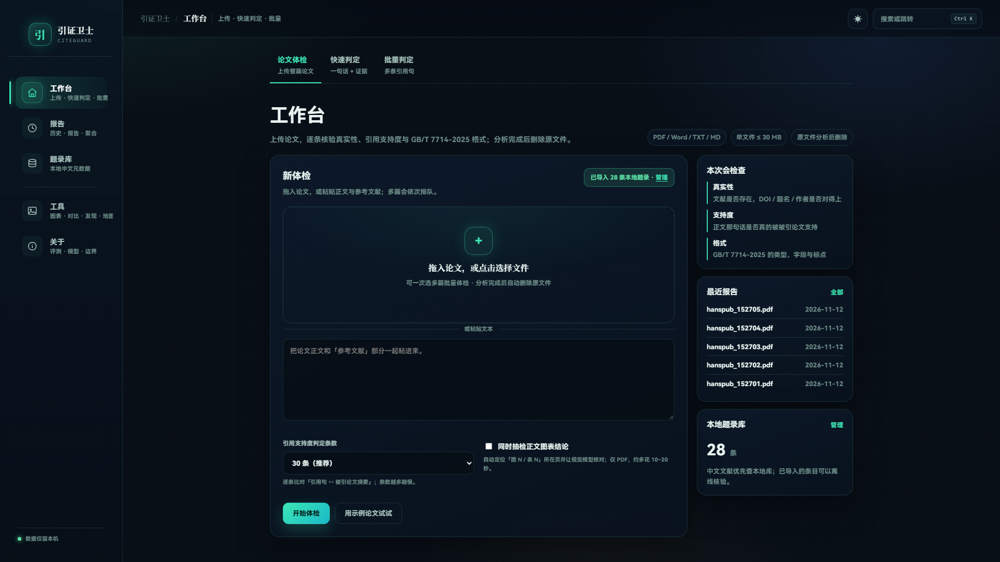
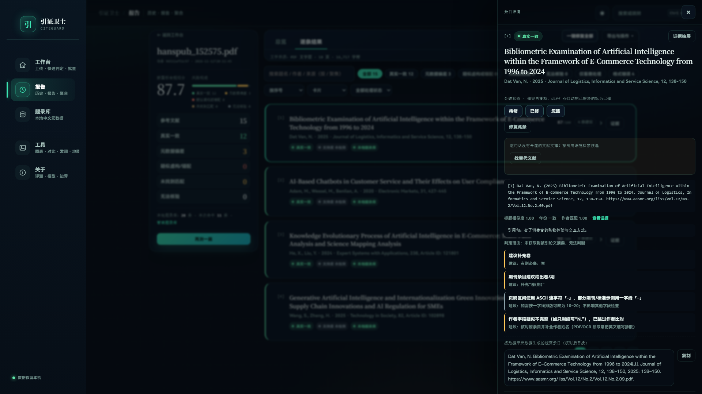
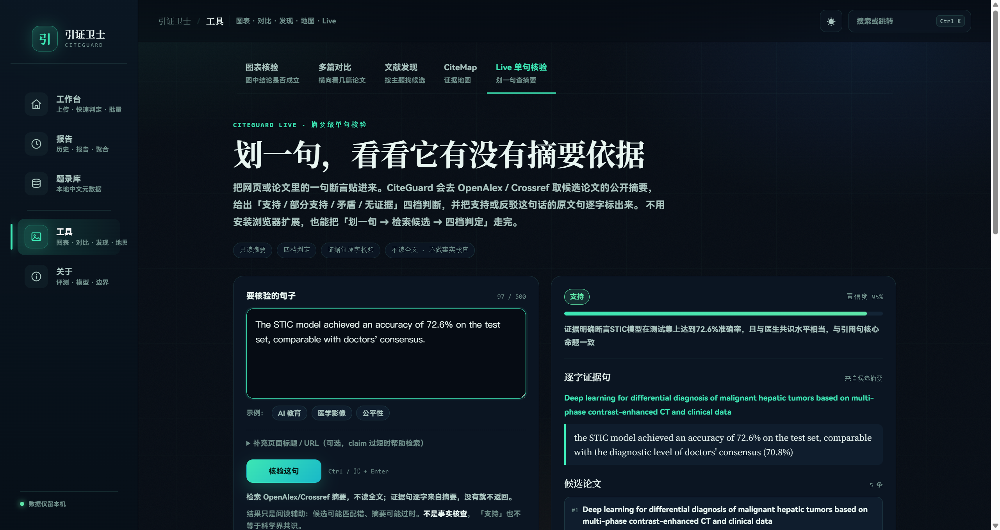
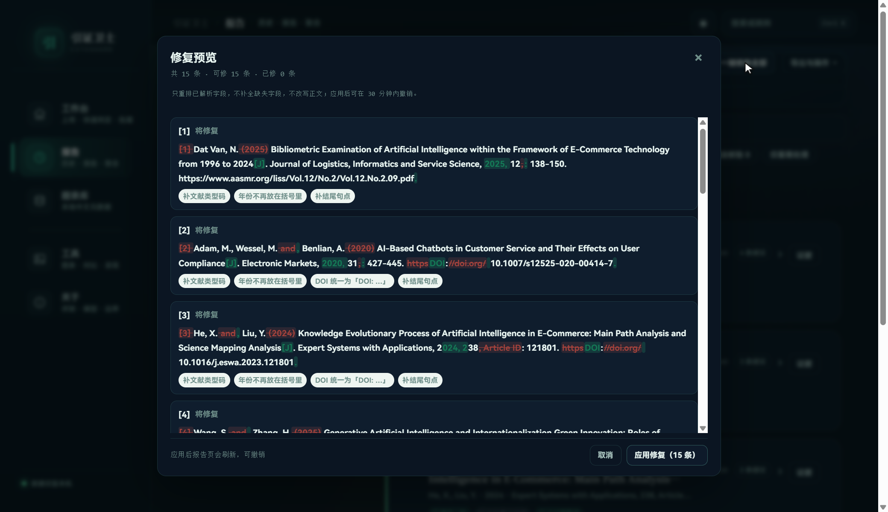

# 使用场景：四类真实任务，四条可复现路径

这一页不是用户调研，也不是“客户证言”。它用仓库里可复现的真实论文与真实产品输出，说明 CiteGuard-CN 在四种典型任务里到底替人做了什么、没做什么。每个场景都给出可核对的数字、截图和复现命令。

## 场景一：研究生交初稿前，把参考文献过一遍

**任务**：一篇 10 页中文论文，15 条参考文献，正文 18 处引用。人工逐条查 DOI/期刊/年份通常要 3–5 小时。

**实际输出**（任务 `96511af51c97`，`data/real_corpus/hanspub_152575.pdf`）：

- 15 条参考文献：12 条 Exact、3 条 Minor、**0 条严重不符（Major）**；平均 GB/T 格式分 87.7。
- 正文 18 处引注全部定位到条目；15/15 条被正文引用，未引用 0 条。
- 报告页首屏先给结论与健康分，逐条结果可展开证据抽屉；每条给出“为什么这样判”的来源与建议。





**没做什么**：不查重、不判断论文本身质量、不替代导师；查不到时显示 Unverified/Unknown，不臆造“已核实”。

复现：

```bash
python -m uvicorn web.app:app --port 8013
# 打开 /workspace，上传上面这篇 PDF
```

## 场景二：编辑/审稿人看到一句可疑表述，先查“这句话有没有来源”

**任务**：审稿时看到“STIC 模型准确率 72.6%，达到医生共识水平（70.8%）”，需要快速判断这句话是否有公开摘要支持。

**实际输出**（产品 `/live`，云端判官，fast 两段）：

- 先返回 5 条候选（约 0.7 s“判定中…”），再给出判定：**支持 95%**。
- 证据句是候选摘要里的逐字原文：`the STIC model achieved an accuracy of 72.6% on the test set, comparable with the diagnostic level of doctors' consensus (70.8%)`。
- 明确标注“只读摘要、不读全文、不是事实核查”。



**可复现的边界**：公开页 30 句 hit@3 0.700；冻结 held-out 30 句 hit@3 1.000（页面引用映射 + 摘要补全后）；中文跨语言仍 0/30；配判官后的 P50 约 3.1 s（fast、页面热缓存）。这些数字都标了数据集和 n，不混算。

复现：

```bash
curl -X POST http://127.0.0.1:8013/api/live/check \
  -H 'Content-Type: application/json' \
  -d '{"claim":"The STIC model achieved an accuracy of 72.6%...","page_title":"Deep learning for hepatic tumors","mode":"fast"}'
```

## 场景三：做领域综述前，把“论文—断言—证据—缺口”摊开

**任务**：两个主题、30 篇开放论文，想先看每篇论文的断言分别被哪些摘要支持/反驳，还缺哪类证据。

**实际输出**（`/citemap`，2026-11 版本）：

- 2 个主题 × 15 篇开放论文，30/30 DOI 可解析；10 条人工示例 + **42 条摘要级机器抽取**（25/30 篇有证据，逐字引用不合格 0）。
- 机器抽取在 10 对人工示例上覆盖 6 对、立场一致 6/6；页面明确区分“人工示例”“机器抽取（仅摘要）”，`verified=false`，不冒充人审。
- 60 格分层核对包（全量 105 格的 57%）与三人盲标 CSV 已可导出；未回收前不写“已人工核对”。


**没做什么**：不承诺全量抽取准确率，不把机器抽取当人工金标，不把“没找到证据”说成“论文是假的”。

复现：

```bash
# 打开 /citemap?topic=ai_education
python scripts/build_citemap_verification.py
python scripts/build_citemap_audit_csv.py
```

## 场景四：发现格式/字段问题后，批量修复并留撤销点

**任务**：15 条参考文献存在文献类型码、年份括号、作者分隔符等格式问题，需要批量重排但不想破坏原报告。

**实际输出**（报告页“一键修复”）：

- 预览 15 条全部可重排、15 条字段完整；确认后写 `report.fixed.json` + `repair.json`，原 `report.json` 保持只读。
- 30 分钟内可一键撤销；撤销后回到未修复状态；逐条也可单独修复。



**没做什么**：不补全缺失字段；字段不完整的条目标 `*`，不伪造作者/卷期/DOI。

## 这些场景对应评分表哪里

| 评分项 | 本页能提供的证据 | 仍缺什么 |
|---|---|---|
| 问题与场景 15 | 中文论文初稿、审稿单句、领域综述、格式修复四类真实任务 | 真人用户访谈/问卷（本轮不做） |
| 创新与方案 20 | 两段式 Live、引用标记映射、CiteMap 人机分层、修复闭环 | 与商业工具的同口径对比（无授权，不造） |
| AI+开源 20 | 云端/本地模型可切换、ECharts/OpenAlex/Crossref 许可清单、SBOM、AI 使用说明 | 上游代码贡献（仅有已关闭的 RefChecker PR） |
| 完成度与可验证 25 | 每场景可运行、可截图、有 n/来源/复现命令；908 项测试、CI | 5–8 人可用性测试（需真人） |
| 开放成果 15 | GitHub 源码/文档、HF 数据集与 1.7B/4B adapter、Docker、API/SDK/MCP | 正式 Release 资产与社区维护记录 |
| 材料规范 5 | 技术报告 15 页、AI 使用说明、资源清单、匿名检查 | 答辩 PPT/视频由团队另做 |

> 所有场景均为仓库内真实论文/真实输出；没有伪造用户、没有把 AI 核对写成人工核对。
